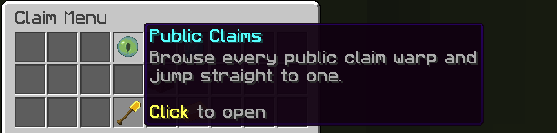
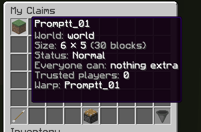
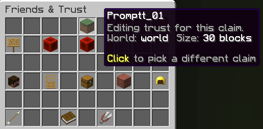
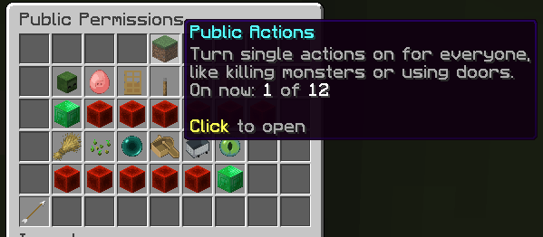
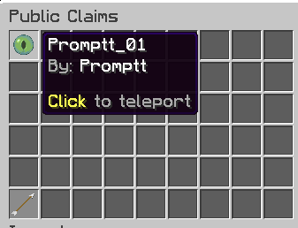

<h1 align="center">LeafClaims</h1>

<p align="center">
  <b>Claims, trust, claim warps and a full Claim Menu for Paper and Fabric — Minecraft 26.2 and 26.3.</b><br/>
  <sub>Based on <a href="https://github.com/WiIIiam278/HuskClaims">HuskClaims</a> 1.5.11 by William278 (Apache-2.0).
  LeafClaims is an independent fork: it is not made, endorsed or supported by William278.</sub>
</p>

<p align="center">
  <a href="https://github.com/Promptt001/LeafClaims/releases/latest">Download</a> ·
  <a href="docs/Claim-Menu.md">Claim Menu</a> ·
  <a href="docs/Claim-Warps.md">Claim warps</a> ·
  <a href="docs/Fabric.md">Fabric, singleplayer &amp; LAN</a> ·
  <a href="CHANGELOG.md">Changelog</a> ·
  <a href="https://github.com/Promptt001/LeafClaims/issues">Issues</a>
</p>

<p align="center">
  
</p>

LeafClaims is a golden-shovel grief prevention plugin, with the things
players kept asking for:

- a **Claim Menu** (`/claimgui`) you can do everything from,
- **claim warps** so people can visit each other's builds (`/claimwarp`, `/visit`, `/visits`),
- **claim names**, and
- **Fabric** support for dedicated servers, **singleplayer** and **Open to LAN**, where
  friends join with a plain vanilla client.

Everything LeafClaims already does is still here: golden-shovel claiming, trust levels,
child and admin claims, claim blocks, user groups, LuckPerms trust, map hooks, cross-server
sync, and the GriefPrevention importer. LeafClaims is built on upstream's current
development line, so it also includes upstream work that no released version of HuskClaims
has yet, such as `/reduceclaim` and MongoDB support (see the
[changelog](CHANGELOG.md#included-from-upstream-huskclaims-since-1510)).

## 🧭 Claim Menu

`/claimgui` opens the Claim Menu: **Public Claims**, **Friends & Trust**, **My Claims**,
**Claim tool** and **Claim Blocks**.

<table>
  <tr>
    <td align="center" width="50%">
      <br/>
      <sub><b>My Claims</b> — every claim you own, with its size, status, access and warp on hover</sub>
    </td>
    <td align="center" width="50%">
      <br/>
      <sub><b>Friends &amp; Trust</b> — the claim you are editing is named on every entry</sub>
    </td>
  </tr>
  <tr>
    <td align="center" width="50%">
      <br/>
      <sub><b>Public Permissions</b> — turn on one action for everyone, with a count of how many are on</sub>
    </td>
    <td align="center" width="50%">
      <br/>
      <sub><b>Public Claims</b> — every warp you may visit; click to teleport</sub>
    </td>
  </tr>
</table>

- **My Claims**: every claim you own as an icon, paged and sortable, child claims included.
  Click one to open its settings; you do not have to stand in it. **Create Claim** is here.
- **Claim settings** (per claim): rename · make private · Friends & Trust · Public
  Permissions · trusted players · child claims · resize · claim warp · unclaim.
- **Friends & Trust**: trust and untrust players, groups and everyone, pick a trust level,
  and see every trustee by name and head. In the menu, *everyone* can be trusted up to the
  Container level by default (`gui.public_access.max_level`); the `/trust` command keeps
  upstream's rules.
- **Public Permissions**: let everyone use one action (doors, buttons, farming, and so on)
  without trusting anyone. Also switches the claim's warp between public and trusted-only.
- **Create Claim** and **Resize**: step the size up and down and see the claim-block cost
  live before you confirm. Works without holding the golden shovel by default
  (`gui.create_claim.bypass_tool_requirement`); the `claim` command permission is always
  required.
- **Claim Blocks**: see your balance, buy blocks (needs an economy plugin), and gift blocks
  to a friend (needs `leafclaims.command.claimblocks.gift`, operators by default).
- **Public Claims**: every claim warp you may visit; click to teleport.
- **Claim tool**: hands you the claim tool (60 s cooldown, never a second one). A tool from
  the menu cannot be smelted, used as fuel or repaired into free gold.

**Safety by design.** Anything that changes a claim or spends claim blocks asks you to
confirm. Every click re-checks the real command permission and your trust in *that*
claim, looked up again at click time. A menu left open while its claim is deleted or
transferred says so instead of acting on the wrong land. Menu items can never be taken
out of a menu.

**Make it yours.** Every slot, row count and icon is configurable in `config.yml` under
`gui:`. When an update changes the default layout, your old `config.yml` is backed up first.

On **Paper**, menus are normal inventory screens and you type text in chat (`cancel` to
abort). On **Fabric**, menus are server-side screens and you type text in an anvil (close it
to cancel). **Players never need a client mod.**

## 🌀 Claim warps

Claim owners set one warp per claim: great for shops, farms and community builds. Anyone
may visit a **public** warp, by name or from the Public Claims menu. A **trusted-only**
warp is for the owner, players with Build or Manage trust, and admins; it appears only in
their Public Claims menu, never in `/visit` or `/visits`.

- `/claimwarp set <name>` where you stand · `/claimwarp rename <name>` · `/claimwarp unset`
- `/visit <name>` · `/visits [page]` (clickable list)
- **Anti-trap:** the landing spot is checked when the warp is set **and again before every
  visit**: no lava, fire, magma, cactus, powder snow, cobwebs, portals, mid-air or
  walled-in spots.
- Bans and private claims are respected. A warp left outside its claim after a resize
  stops working until it is moved.
- Switch a warp between public and trusted-only in the claim's Public Permissions menu.
- Names are unique on the server and use letters, numbers, `_`, `.` and `-` only (no
  spaces), up to 32 characters by default.
- Who may manage a warp: the owner, players with the `MANAGE_WARP` trust privilege (given
  to the Manage level in new installs), and admins with `leafclaims.command.claimwarp.other`.

## 🏷️ Claim names

Claims get readable names (`Steve_01`, `Steve_02`, …) that you can change from the menu.
Setting a warp names the claim after the warp unless you chose a name yourself.

## 🧵 Fabric, singleplayer and LAN

- **Dedicated Fabric servers**: the same features as Paper.
- **Singleplayer**: install the mod on your client and claim in your own world. Each
  world keeps its own claims (`saves/<world>/leafclaims/`).
- **Open to LAN**: friends join with a **vanilla** client and can claim and use
  `/claimgui` under the host's rules. LAN guests never become LeafClaims admins, even when
  the world was opened with commands allowed (`fabric.yml` can change that).

## 🛠️ Fixes over upstream HuskClaims

SQLite claim-world ids (claim worlds could overwrite each other), Fabric placement
protection (placement was checked at the player instead of the target block; wrong block on
east/south/top faces), the Fabric claim outline offset, Fabric crop handling, and
`/leafclaims status` on Paper 26.2. Full list in the [changelog](CHANGELOG.md).

## Supported platforms

The release carries four jars. Which one you need depends on the server software and the
Minecraft version, and the Java version differs between them.

| Jar | Server | Minecraft | Java |
|---|---|---|---|
| `LeafClaims-Paper-2.0.0.jar` | Paper | 26.3, 26.2 | **25** |
| `LeafClaims-Bukkit-2.0.0.jar` | Spigot-family servers | Untested — see below | **21** |
| `LeafClaims-Fabric-2.0.0+mc.26.3.jar` | Fabric | 26.3 | **25** |
| `LeafClaims-Fabric-2.0.0+mc.26.2.jar` | Fabric | 26.2 | **25** |

**Paper** is the recommended server. The Paper jar is the complete plugin.

**The Bukkit jar is the base plugin underneath the Paper jar**, and it is published separately
because it is also usable on its own. On a Spigot-family server it loads with no Paper
classes present. LeafClaims does not test or support Spigot, so treat that as untested rather
than endorsed: it targets the Bukkit API at `api-version` 1.17 and is compiled for Java 21, so
a very old server cannot host it. If you run Paper, use the Paper jar.

**Folia** is declared supported in the Paper plugin manifest, inherited from upstream HuskClaims,
but LeafClaims has not run it on Folia.

The Fabric builds are split by game version and are not interchangeable: use the `+mc.26.3`
jar on 26.3 (Fabric Loader **0.19.5+**) and the `+mc.26.2` jar on 26.2 (Loader **0.19.3+**).
Each accepts the hotfix releases of its own version (`~26.3`, `~26.2`), so a 26.3 hotfix needs
no new download. Both Fabric builds also require **Fabric API**; everything else, including the
ClopLib Fabric port and the server-side menu library, is bundled inside the jar.

These requirements are read from the jars themselves: the Fabric versions come from
`fabric.mod.json` inside each jar, and the Java versions from the class-file version of the
compiled classes.

## Install

**Paper:** put `LeafClaims-Paper-2.0.0.jar` in `plugins/` and restart. Files live in
`plugins/LeafClaims/`.

**Fabric server:** put `LeafClaims-Fabric-2.0.0+mc.26.3.jar` (or the `+mc.26.2` jar on a 26.2
server) and Fabric API in `mods/` and restart. Files live in `config/leafclaims/`.

**Singleplayer / LAN host:** put the matching Fabric jar and Fabric API in your client's
`mods/` folder. Settings live in `.minecraft/config/leafclaims/` (shared by all your worlds);
each world's claims live in `saves/<world>/leafclaims/`. LAN guests install nothing.

Check the download against `SHA256SUMS.txt` on the release page.

### Upgrading

- **From HuskClaims 1.5.x (upstream):** back up, then replace the jar (remove the old one).
  LeafClaims uses the same plugin name, data folder, database, commands and permission
  nodes. New settings (`gui:`, `claims.warps:`) and new messages are added to your files
  automatically.
  - Your existing `trust_levels.yml` is **not** changed. To let Manage-trusted players
    manage claim warps, add `MANAGE_WARP` to the `privileges` of your `manage` level.
  - New installs only: the default **Access** and **Container** levels no longer allow
    placing or breaking vehicles (Build and Manage still do).
- **From "HuskClaims with Visits" 1.5.11-visits.1:** replace the jar. Your warps are kept.
- **Going back to upstream HuskClaims** works, but upstream does not know about warps or
  claim names: warps are dropped the next time upstream saves a claim world. Remove
  `MANAGE_WARP` from `trust_levels.yml` first.
- **Networks:** every server that shares a LeafClaims database or Redis broker must run the
  same LeafClaims version. Do not mix LeafClaims and upstream HuskClaims servers on
  one network.

## Commands added by LeafClaims

| Command | What it does | Permission | Default |
|---|---|---|---|
| `/claimgui` (also `/leafclaimgui`) | Open the Claim Menu | `leafclaims.command.leafclaimgui` | everyone |
| `/claimwarp set <name>` | Set this claim's warp where you stand | `leafclaims.command.claimwarp` + owner or `MANAGE_WARP` trust | everyone |
| `/claimwarp rename <name>` · `/claimwarp unset` | Rename or remove this claim's warp | same | everyone |
| `/visit <name>` | Teleport to a public claim warp | `leafclaims.command.visit` | everyone |
| `/visits [page]` | Clickable list of public claim warps | `leafclaims.command.visits` | everyone |

| Extra permission | What it allows | Default |
|---|---|---|
| `leafclaims.command.claimwarp.other` | Manage warps on other players' claims; use any trusted-only warp from the Public Claims menu | operators |
| `leafclaims.gui.claim_tool` | Get a claim tool from the Claim Menu | everyone |
| `leafclaims.gui.public_permissions` | Use the Public Permissions menu (each action also needs `leafclaims.flag.<action>`) | everyone |

Every menu button runs the matching LeafClaims command, so it needs that command's
permission (for example `/trust`, `/unclaim`, `/buyclaimblocks`, or
`leafclaims.command.claimblocks.gift` for gifting). The menu never grants anything the
command would not. All upstream commands and permissions are unchanged: see the
[LeafClaims commands docs](docs/Commands.md).

## Configuration

- `config.yml` → `gui:`: the Claim Menu (on/off, layout, icons, claim-tool cooldown,
  public-access cap, which public permissions owners may toggle, create/resize steps).
  See [Claim Menu](docs/Claim-Menu.md).
- `config.yml` → `claims.warps:`: claim warps (on/off, name length, unique names, visit
  cooldown). See [Claim warps](docs/Claim-Warps.md).
- `fabric.yml` (Fabric only): the LAN guest operator rule. See [Fabric](docs/Fabric.md).
- Everything else is upstream HuskClaims configuration:
  [LeafClaims config docs](docs/Config.md).

Update checks compare your version with this repository's GitHub releases (turn them off
with `check_for_updates: false`). LeafClaims sends no metrics.

## Translations

LeafClaims ships the 7 upstream languages (en-gb, it-it, pt-br, ro-ro, ru-ru, zh-cn,
zh-tw). The new Claim Menu and warp texts are English in every file for now. Translations
are very welcome as pull requests to `common/src/main/resources/locales/`.

## Building from source

You need JDK 21 and JDK 25, and nothing else. A plain clone builds every jar; there is
no separate library to install first.

This is a self-contained build with no upstream `net.william278` dependencies. The libraries
it used to compile against are now ordinary source in this repository:

- `net.william278.cloplib` — ClopLib 2.0.13 (common, bukkit and fabric, including its mixins)
- `net.william278.toilet` — Toilet 1.1.2 (common, bukkit and fabric)
- `net.william278.desertwell` — DesertWell 2.0.4
- `net.william278.paginedown` — Paginedown 1.1.2

Nothing is resolved from `repo.william278.net`, and nothing is vendored as a jar. A clone builds
offline once the ordinary public dependencies are cached.

```bash
git clone https://github.com/Promptt001/LeafClaims && cd LeafClaims
JAVA_HOME=/path/to/jdk-21 ./gradlew :common:build :bukkit:build
JAVA_HOME=/path/to/jdk-25 ./gradlew :paper:build :fabric:26.2:build :fabric:26.3:build
# jars: target/LeafClaims-Paper-<version>.jar
#       target/LeafClaims-Bukkit-<version>.jar
#       target/LeafClaims-Fabric-<version>+mc.26.2.jar
#       target/LeafClaims-Fabric-<version>+mc.26.3.jar
```

Release tags are plain version numbers owned by this repository (`2.0.0`, `2.0.1`, …,
no `v`); the update checker reads them. Upstream's tags are not mirrored here.

## License and credits

LeafClaims is licensed under the [Apache License 2.0](LICENSE), like the HuskClaims project it
is derived from. See [NOTICE](NOTICE) and [THIRD_PARTY_LICENSES.md](THIRD_PARTY_LICENSES.md).

- **[HuskClaims](https://github.com/WiIIiam278/HuskClaims)** by [William278](https://william278.net/)
  and contributors: the plugin this fork is built on. Please do not ask William278 or the
  HuskClaims team for help with LeafClaims.
- **LeafClaims** is maintained by [Promptt001](https://github.com/Promptt001).
- Uses [sgui](https://github.com/Patbox/sgui) (LGPL-3.0) for server-side menus on Fabric.
  ClopLib, Toilet, DesertWell and Paginedown are part of this repository as source, adapted
  from William278's originals; the build downloads no ClopLib artifact. Licences for each are
  listed in [THIRD_PARTY_LICENSES.md](THIRD_PARTY_LICENSES.md).

## Support

Found a bug or have an idea? [Open an issue](https://github.com/Promptt001/LeafClaims/issues).
Please include your platform (Paper/Fabric), Minecraft version, and the line from
`latest.log` that says `Successfully enabled LeafClaims v…`.
